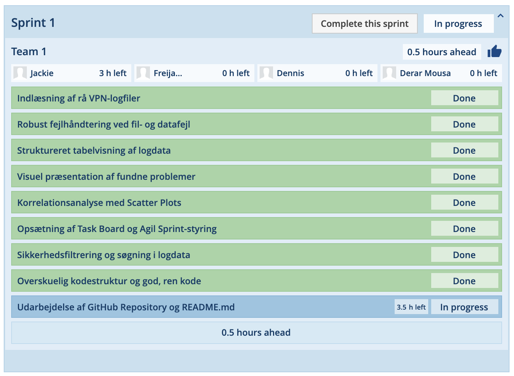

# bumlebusiness
Dette er vores Github project, hvor vi skal bruge SCRUM og indlæse, vise, analysere og visualisere logs


## Introduktion

> **Mangler:** En kort beskrivelse af projektet, dets formål og den problemstilling, det skal løse.


## SCRUM

> **Mangler:** En forklaring af SCRUM som arbejdsmetode og af de fem elementer nedenfor.

### Sprint

> **Mangler:** Hvordan projektet er planlagt og gennemført i ét sprint.

*[Screenshot: sprintplan]*


### User Stories

> **Mangler:** Hvad en User Story er, og hvordan de bruges i projektet.

*[Screenshot: User Stories]*


### Tasks

> **Mangler:** Hvad Tasks er, og hvordan de knyttes til User Stories.

*[Screenshot: Tasks i ScrumWise]*
<!--  -->
*Liste over vores Tasks i Scrumwise*
**US1: Indlæsning af rå VPN-logfiler**
- Opret python fil til filhåndtering.
- Opret funktion til indlæsning af logfil, cyber_security_log_sample.txt.
- Verificer at alle rækker og kolonner er blevet indlæst.

**US2: Robust fejlhåndtering ved fil- og datafejl**
- Tilføj try-except i data_loader.py.
- Test programmet med en ugyldig filsti og manglende fil.

**US3: Struktureret tabelvisning af logdata**
- Implementér formatering vha. f.eks. tabulate eller indbygget Pandas print.
- Opret visningsfunktion.

**US4: Sikkerhedsfiltrering og søgning i logdata**
- 

### Acceptkriterier

> **Mangler:** Hvad Acceptkriterier bruges til, og hvordan de definerer, hvornår en opgave er løst.

*[Screenshot: Acceptkriterier i ScrumWise]*
<!--  -->

### Task Board

> **Mangler:** Hvad Task Boardet bruges til, og hvordan det giver overblik over projektets opgaver.

*[Screenshot: Task Board i starten af sprintet]*
<!--  -->

*[Screenshot: Task Board midt i sprintet]*
<!--  -->

*[Screenshot: Task Board til sidst, alle opgaver i Done]*
<!--  -->

### Sammenhængen mellem User Stories, Tasks, Acceptkriterier og Task Board

> **Mangler:** Hvordan de fire elementer hænger sammen.


## Kom i gang

Kræver Python 3. Kør kommandoerne i projektets rodmappe.

**Windows (PowerShell eller Kommandoprompt)**

```bash
python -m venv .venv
.venv\Scripts\activate
pip install -r requirements.txt
python main.py
```

Hvis PowerShell blokerer aktiveringen, kan du køre `Set-ExecutionPolicy -Scope CurrentUser RemoteSigned` og prøve igen.

**macOS og Linux**

```bash
python3 -m venv .venv
source .venv/bin/activate
pip install -r requirements.txt
python main.py
```

Hvis `python` ikke findes på macOS eller Linux, så brug `python3 main.py`.

Når du er færdig, kan du afslutte det virtuelle miljø med `deactivate`.


## Udviklingsproces

<details>
<summary><b>Data Loader – Udvikling og implementering</b> (klik for at åbne)</summary>


Denne sektion beskriver udviklingen af `data_loader.py`-modulet, inklusive implementeringsvalg, parsingmetoder, fejlhåndtering og udførte tests.

### 1. Indledende opsætning og fillæsning

Oprettede `data_loader.py`-modulet til at håndtere læsningen og processeringen af de rå VPN-sikkerhedslogs.

- Tilføjede filen `cyber_security_log_sample.txt` til projektets data-mappe.
- Implementerede funktionen `load_logs()`.
- Brugte den indbyggede funktion i Python til at tilgå `.txt`-filen.
- `readlines()` blev brugt til at hente de individuelle loglinjer ind i en liste.
- Tilføjede UTF-8 encoding til at sikre korrekt teksthåndtering.
- Brugte oprindeligt `pathlib` til filhåndtering. Dette blev der stillet spørgsmål til i gruppen, da koden var længere end ved brug af Pythons indbyggede `open()`-funktion.

De indledende tests bekræftede, at filen indeholdt 541 loglinjer.

### 2. Log parsing og dataudtræk

Udviklede `parse_log()`-funktionen til at konvertere de rå loglinjer til en struktureret Python dictionary.

#### Den indledende opsætning med `split()`:

Oprindeligt blev der eksperimenteret med Pythons indbyggede `split()`-funktion til at separere en loglinje i de individuelle felter.

Under tests viste det sig dog, at der var problemer med `msg`-sektionen i loglinjerne, da disse indeholder anførselstegn og mellemrum.

For eksempel:

`msg="User authenticated successfully"`

Ved at bruge `split()` ville denne besked blive opdelt i flere forskellige dele og derved gøre dataanalyse og opdelingen uholdbar i længden.

#### Implementeringen af `shlex`:

For at løse problemstillingen med `msg`-delen af loglinjerne blev `shlex`, som er et standardbibliotek, implementeret.

- Importerede `shlex`.
- Erstattede `split()` med `shlex.split()`.
- Verificering blev udført og bekræftede, at beskeden med anførselstegn og mellemrum nu blev bevaret som et enkelt element.

#### Strukturen af dictionary

Efter opdelingen af de individuelle logdele:

- Oprettede et tomt dictionary til at indeholde hver logpost.
- Tidsstemplet opbevares separat under `timestamp`-key.
- `for`-loop bruges til at processere de resterende felter.
- `split("=", 1)` blev brugt til at separere key og values.

Tidsstemplet blev håndteret separat, da det ikke følger den samme procedure for key og value-struktur som de resterende logdele.

### 3. Håndtering af flere loglinjer samtidig

Efter at have opnået en succesfuld parsing af individuelle loglinjer implementerede jeg processen til at håndtere hele filen.

- Oprindeligt brugte jeg list comprehension til parsing af logdele.
- Opbevarede de resulterende dictionaries i en liste kaldet `parsed_logs`.
- Verificerede, at alle 541 loglinjer blev parsed korrekt.

List comprehension blev senere erstattet af et regulært `for`-loop med brugen af `enumerate()`.

Denne ændring gjorde, at programmet kunne holde styr på individuelle linjenumre, som gjorde det muligt at identificere og rapportere logindtastninger, der var misdannede.

Nummereringen med `enumerate()` starter med 1 for at matche linjenumrene i logfilen i stedet for Pythons default 0-baserede indeksering.

### 4. Exception-håndtering og fejlvalidering

Den oprindelige implementering blev udvidet til at håndtere manglende filer og misdannede logindtastninger.

#### 4.1 Filindlæsning og exception-håndtering

Tilføjede `try/except`-håndtering til `load_logs()`.

- Implementerede `FileNotFoundError`-håndtering via `except`.
- Tilføjede en fejlbesked, når TXT-filen ikke kunne findes.
- Returnerer `None`, hvis indlæsning fejler.
- Tilføjede et check i hovedprogrammet til at forhindre videre processering, når ingen logs blev indlæst.

Testet ved midlertidigt at fejltaste filnavnet til en ikke-eksisterende fil.

**Resultat:** Fejlen blev fanget, en passende besked blev vist, og programmet afsluttede uden nogen fejl.

#### 4.2 Tomme logindtastninger

Tilføjede verificering ved at bruge:

`if not parts:`

Det checker, om `shlex.split()` returnerer en tom liste.

- Tomme indtastninger genererer en fejlbesked.
- Parseren returnerer `None`.
- Hovedprocesseringsloopet identificerer en ugyldig indtastning og fortsætter med de resterende linjer.

Dette er blevet testet ved midlertidigt at indsætte en tom linje i loglisten.

**Resultat:** Den tomme linje blev identificeret ved (som eksempel) linje 3, og de resterende linjer blev processeret korrekt og med succes.

#### 4.3 Tidsstempelvalidering

Oprindeligt blev tidsstempelverificeringen udført ved brug af et check på de første 4 værdier ved hjælp af `.isdigit()`.

Denne tilgang blev forbedret ved brug af Pythons `datetime`-modul (tak til Klaus for denne idé).

Implementeringen:

`datetime.strptime(parts[0], "%Y-%m-%dT%H:%M:%S")`

Dette validerer det komplette tidsstempel imod det forventede format.

- Ugyldige tidsstempler genererer en fejlbesked.
- Det berørte linjenummer og tidsstemplet identificeres og vises i udskriften.
- Ugyldige indtastninger afvises ved at returnere `None`.

Testet ved brug af en ugyldig datoindtastning.

**Resultat:** Det ugyldige tidsstempel blev korrekt identificeret og afvist.

#### 4.4 Key-Value-validering

Tilføjede validering for at sikre, at hver del efter tidsstemplet indeholder et `=`-tegn.

- Checker hver del af loglinjen fra indeks `[1]` (efter tidsstemplet) individuelt ved brug af `"=" in part`.
- Valide dele bliver splittet op i keys og values.
- Ugyldige dele genererer en fejlbesked, som indeholder linjenummer og den misdannede del fra linjen i logfilen.

Testet ved brug af en misdannet del (`level INFO`) uden `=`-tegn.

**Resultat:** Den ugyldige del blev identificeret og afvist uden at afbryde processeringen af de resterende logindtastninger.


</details>

<details>
<summary><b>Table View – Udvikling og implementering</b> (klik for at åbne)</summary>

`table_view.py` viser loggen som en tabel med overskrifter og løser US3. Man kan vælge at se de første eller de seneste 20 linjer.

### Valget af pandas

Vi har kun lært om plotly og matplotlib i undervisningen. Efter lidt research blev vi enige om at bruge pandas, fordi det er lavet til at arbejde med data og gør det nemt at lave rå data om til noget mere overskueligt, som vi kan bruge videre. Derfor gik vi direkte til pandas i stedet for først at prøve noget andet. Det gik også nemt, fordi `data_loader.py` allerede var færdig og gav os en liste med dictionaries, som pandas kan gøre til en tabel med det samme.

### build_table()

Funktionen henter loglinjerne med `load_logs()`, parser dem med `parse_logs()` og laver en DataFrame ud af resultatet. Hver loglinje bliver til en række, og felterne (`timestamp`, `level`, `event` osv.) bliver til kolonner med overskrifter.

Bagefter laver vi to konverteringer, så data ikke bare er tekst (strings), når vi skal lave grafer:

- `timestamp` bliver lavet om til datetime med `pd.to_datetime()`.
- `dest_port` bliver lavet om til et tal med `pd.to_numeric(..., errors="coerce")`.

`errors="coerce"` bestemmer, hvad der sker, hvis en værdi ikke kan laves om til et tal. Uden den stopper programmet med en fejl. Med den bliver værdien i stedet til en tom værdi (`<NA>`), og resten af tabellen virker stadig som normalt.

### Første eller seneste 20 linjer

Til visningen bruger vi `head()` og `tail()`. De er basale funktioner, som også findes i Linux, og dem kendte vi i forvejen, så det gav god mening at bruge dem. `show_table()` viser de første 20 linjer, og `show_latest()` viser de seneste 20. Begge bruger `to_string(index=False)`, så pandas ikke skjuler kolonner med `...`, og så det ekstra rækkenummer ikke kommer med.

I `main.py` spørger menupunkt 1, om man vil se de første eller de seneste 20 (`f` eller `l`). Tabellen bygges kun én gang, når programmet starter, og bruges derefter af resten af menuen.

### Fejlhåndtering og test

Vi har testet, hvad der sker, hvis logfilen ikke findes. `load_logs()` returnerer så `None`, `build_table()` returnerer også `None`, og `main.py` skriver "No logs found" og stopper uden at crashe. Vi har også testet, at ugyldige loglinjer ikke kommer med i tabellen. De bliver sorteret fra i `parse_logs()`, før tabellen bliver lavet.

*[Screenshot: tabel med de første 20 linjer]*
<!--  -->

*[Screenshot: tabel med de seneste 20 linjer]*
<!--  -->

### Refleksion

Vi har arbejdet på det sammen og hjulpet hinanden. Set i bakspejlet kunne vi godt have overvejet en SQL-database i stedet for en tabel i `table_view.py`. Så kunne vi have brugt SQL-queries, især til søgning og filtrering, og det kunne have gjort det lettere og mere enkelt at hente data.

</details>

<details>
<summary><b>Analyzer – Udvikling og implementering</b> (klik for at åbne)</summary>

> **Mangler:** Hvad `analyzer.py` gør, og hvordan US4 er løst (filtrering på status, IP og tidsrum, søgning på IP/bruger/event, brute force-detektion). Skriv også om valg, funktioner og fejlhåndtering.

</details>

<details>
<summary><b>Visualization – Udvikling og implementering</b> (klik for at åbne)</summary>

> **Mangler:** Hvad `visualization.py` gør, og hvordan US5 og US6 er løst (scatter plots, søjle- og linjediagrammer, diagrammer med titel, akser og signaturforklaring). Skriv også om, hvilke sammenhænge i logfilen I fandt, og hvorfor I valgte netop de diagramtyper.

</details>

<details>
<summary><b>Main – Udvikling og implementering</b> (klik for at åbne)</summary>

> **Mangler:** Hvad `main.py` gør, og hvordan det binder modulerne sammen i en menu (US7: hele programmet startes fra `main.py`). Skriv også om, hvordan I har arbejdet med US8 og US9 (Task Board, GitHub og README).

</details>

# Konklusion

## Resultater

> **Mangler:** En opsummering af det færdige projekt og de vigtigste resultater.

## Forbedringsmuligheder

> **Mangler:** Eventuelle forbedringsmuligheder.


## Kilder

- Claude (Anthropic, AI-assistent): Vi har brugt Claude som hjælp til at strukturere README-filen og til at få overblik over, hvad vi skulle skrive under de forskellige punkter. Indholdet bygger på vores eget arbejde og vores egne svar, hvor vi evt. har kunnet bede Claude som at stille os nogle spørgsmål, som vi ville besvare for at den så kunne skrive det med vores ord.
- Git og Co-Authored-By: Claude: Freijas Git har ikke virket i forhold til push, pull og fetch. Claude har derfor hjulpet med at gøre det for hende. Det er derfor, der står "Co-Authored-By: Claude" i nogle af commit-beskederne.
