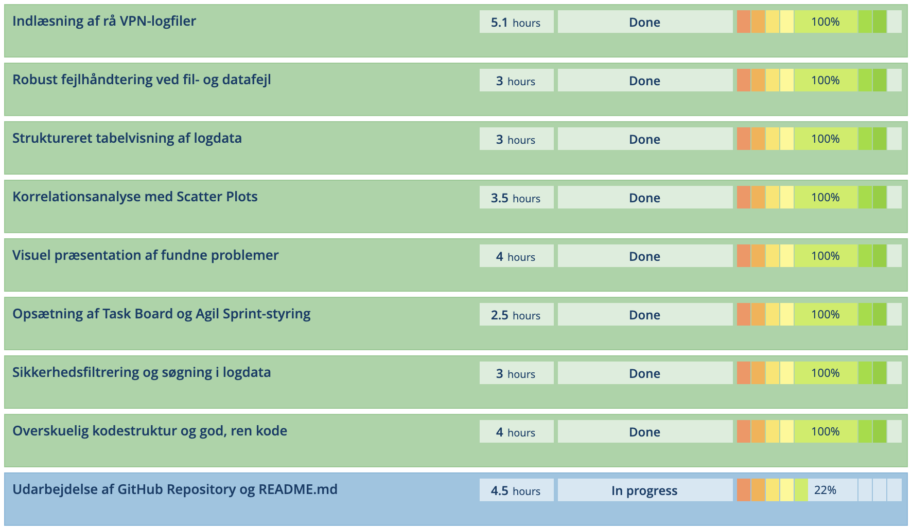
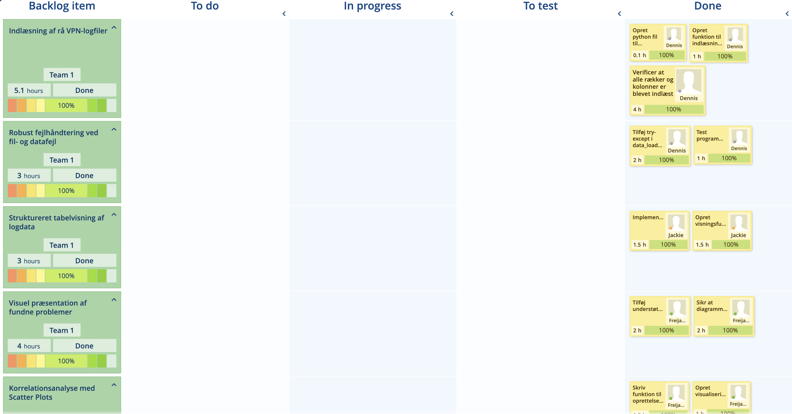
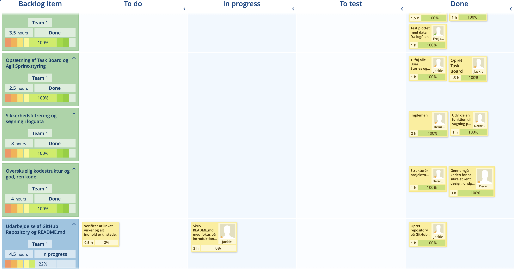
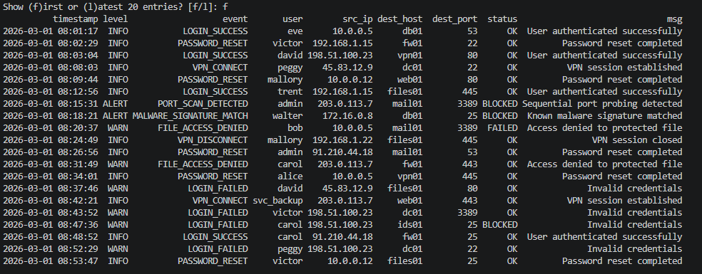
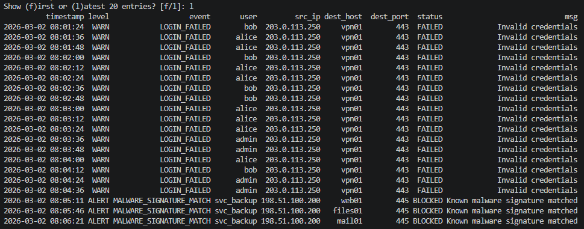

# bumlebusiness
Dette er vores Github project, hvor vi skal bruge SCRUM og indlæse, vise, analysere og visualisere logs


## Introduktion

Bumle Business har VPN sikkerhedslogs, og vi har lavet et program der indlæser, viser,
analysere, og visualiserer dem.
Problemstillingen ved opgaven, er logfilen har 541 linjer og det er svært og langsomt
at finde mistænkelig aktivitet manuelt. Så formålet med opgaven er, at gøre det nemt at
filtrere og søge for, at finde mislykkede logins, blokerede forsøg og bestemt IP'er
så man hurtigt kan opdage angreb.
Projektet er lavet via pycharm, VS Code, og Scrum.

## SCRUM

**SCRUM er et effektivt arbejdsværktøj hvor man arbejder i perioder (Sprints), og løbende tilpasser sit arbejde.**

### Sprint

**Et Sprint er en fast periode hvor man vælger hvilket User Stories der skal laves indenfor det planlagte Sprint.**

*[Screenshot: sprintplan]*


### User Stories

**User Stories beskriver hvad brugere har brug for og hvorfor. I projektet bruges de til at bestemme hvad der skal bygges.**

<details>
<summary>Vis User Stories (klik for at åbne)</summary>

*[Screenshot: User Stories]*


</details>

### Tasks

**Tasks er små opgaver som en User Story deles op i. En User Story er færdig når de tilhørende tasks er løst.**

<details>
<summary>Vis tasks (klik for at åbne)</summary>

*Liste over vores Tasks i Scrumwise*

**US1: Indlæsning af rå VPN-logfiler**
- Opret python fil til filhåndtering.
- Opret funktion til indlæsning af logfil, cyber_security_log_sample.txt.
- Verificer at alle rækker og kolonner er blevet indlæst.


**US2: Robust fejlhåndtering ved fil- og datafejl**
- Tilføj try-except i data_loader.py.
- Test programmet med en ugyldig filsti og manglende fil.


**US3: Struktureret tabelvisning af logdata**
- Implementér formatering vha. f.eks. tabulate eller indbygget Pandas print.
- Opret visningsfunktion.


**US4: Sikkerhedsfiltrering og søgning i logdata**
- Implementér filtreringslogik i et analysemodul (analyzer.py).
- Udvikle funktion til søgning på IP/bruger/fejltype.


**US5: Korrelationsanalyse med Scatter Plots**
- Opret visualiseringsmodul.
- Skriv funktion til oprettelse af scatter plots med relevante kolonner fra logfilen.
- Test plottet med data fra logfilen.


**US6: Visuel præsentation af fundne problemer**
- Tilføj understøttelse for søjle-/linjediagrammer i visualization.py.
- Sikr at diagrammerne gemmes eller vises korrekt ved kørsel.


**US7: Overskuelig kodestruktur og god, ren kode**
- Strukturér projektmappen med de aftalte scripts.
- Gennemgå koden for at sikre et rent design, undgå gentagelser, gode kommentarer og variabbel navne.


**US8: Opsætning af Task Board og Agil Sprint-styring**
- Opret Task Board.
- Tilføj alle User Stories og Tasks til boardet.


**US9: Udarbejdelse af GitHub Repository og README.md**
- Opret repository på GitHub og push koden.
- Skriv README.md med fokus på introduktion, metodeforklaring og konklusion.
- Verificer at linket virker og alt indhold er til stede.

</details>


### Acceptkriterier

**Acceptkriterier er tydelige krav som gør det klart hvornår opgaven er løst.**

<details>
<summary>Vis acceptkriterier (klik for at åbne)</summary>

*Liste over vores acceptkriterier i Scrumwise*

**US1: Indlæsning af rå VPN-logfiler**
- Filen cyber_security_log_sample.txt indlæses fejlfrit i en struktureret datastruktur (f.eks. Pandas DataFrame).
- Kolonnenavne og datatyper parses korrekt.
- Programmet bekræfter succesfuld indlæsning i konsollen.


**US2: Robust fejlhåndtering ved fil- og datafejl**
- Hvis cyber_security_log_sample.txt ikke findes, fanges dette med en catch og der udskrives en brugervenlig fejlmeddelelse.
- Ugyldige datarækker eller formater håndteres uden at stoppe hele programmet.


**US3: Struktureret tabelvisning af logdata**
- Tabellen vises med klare kolonneoverskrifter og afrettede rækker.
- Mulighed for at vise et uddrag (f.eks. de første eller seneste 20 loglinjer) for at undgå at overbelaste konsollen.


**US4: Sikkerhedsfiltrering og søgning i logdata**
- Programmet skal kunne filtrere rækker ud fra betingelser (f.eks. statuskode, IP-adresse eller tidsrum).
- De filtrerede resultater præsenteres i en dedikeret oversigt.


**US5: Korrelationsanalyse med Scatter Plots**
- Scriptet genererer mindst ét funktionelt scatter plot ved hjælp af matplotlib.
- Plottet har tydelig titel, akse-labels og signaturforklaring.
- Plottet vises grafisk for brugeren.


**US6: Visuel præsentation af fundne problemer**
- Programmet genererer diagram(mer), der fremhæver fundne problemer (f.eks. trafik-spikes).
- Diagrammerne er intuitive og understøtter konklusionen på sikkerhedsundersøgelsen.


**US7: Overskuelig kodestruktur og god, ren kode**
- Koden er opdelt i moduler (f.eks. main.py, data_loader.py, analyzer.py, visualization.py).
- Funktioner har velvalgte variable- og funktionsnavne samt docstrings/kommentarer.
- Koden kan startes samlet fra main.py.


**US8: Opsætning af Task Board og Agil Sprint-styring**
- Alle ovenstående User Stories er oprettet som elementer på Task Boardet med tilhørende Tasks og acceptkriterier.
- Status på opgaverne opdateres løbende under udviklingen.


**US9: Udarbejdelse af GitHub Repository og README.md**
- Oprettet et offentligt GitHub-repo med kildekode og cyber_security_log_sample.txt.
- README.md indeholder de tre krævede hovedafsnit: Introduktion, SCRUM (forklaring af US, Tasks, Acceptkriterier, Task Board og sammenhæng) og Konklusion.

</details>


### Task Board

**Task Board er en tavle hvor man kan holde styr på alle sine Tasks. De bliver flyttet rundt fra To Do, In Progress til Done alt efter når de bliver løst.**

<details>
<summary>Vis Task Board (klik for at åbne)</summary>

*[Screenshot: Task Board billede 1]*


*[Screenshot: Task Board billede 2]*


</details>


### Sammenhængen mellem User Stories, Tasks, Accheptkriterier og Task Board

**User Stories deles op i Tasks der bliver flyttet rundt på Task boarded i løbet af et Sprint. Acceptkriterier afgør hvornår en User Story er løst.**


## Kom i gang

Kræver Python 3. Kør kommandoerne i projektets rodmappe.

**Windows (PowerShell eller Kommandoprompt)**

```bash
python -m venv .venv
.venv\Scripts\activate
pip install -r requirements.txt
python main.py
```

Hvis PowerShell blokerer aktiveringen, kan du køre `Set-ExecutionPolicy -Scope CurrentUser RemoteSigned` og prøve igen.

**macOS og Linux**

```bash
python3 -m venv .venv
source .venv/bin/activate
pip install -r requirements.txt
python main.py
```

Hvis `python` ikke findes på macOS eller Linux, så brug `python3 main.py`.

Når du er færdig, kan du afslutte det virtuelle miljø med `deactivate`.


## Udviklingsproces

<details>
<summary><b>Data Loader – Udvikling og implementering</b> (klik for at åbne)</summary>


Denne sektion beskriver udviklingen af `data_loader.py`-modulet, inklusive implementeringsvalg, parsingmetoder, fejlhåndtering og udførte tests.

### 1. Indledende opsætning og fillæsning

Oprettede `data_loader.py`-modulet til at håndtere læsningen og processeringen af de rå VPN-sikkerhedslogs.

- Tilføjede filen `cyber_security_log_sample.txt` til projektets data-mappe.
- Implementerede funktionen `load_logs()`.
- Brugte den indbyggede funktion i Python til at tilgå `.txt`-filen.
- `readlines()` blev brugt til at hente de individuelle loglinjer ind i en liste.
- Tilføjede UTF-8 encoding til at sikre korrekt teksthåndtering.
- Brugte oprindeligt `pathlib` til filhåndtering. Dette blev der stillet spørgsmål til i gruppen, da koden var længere end ved brug af Pythons indbyggede `open()`-funktion.

De indledende tests bekræftede, at filen indeholdt 541 loglinjer.

### 2. Log parsing og dataudtræk

Udviklede `parse_log()`-funktionen til at konvertere de rå loglinjer til en struktureret Python dictionary.

#### Den indledende opsætning med `split()`:

Oprindeligt blev der eksperimenteret med Pythons indbyggede `split()`-funktion til at separere en loglinje i de individuelle felter.

Under tests viste det sig dog, at der var problemer med `msg`-sektionen i loglinjerne, da disse indeholder anførselstegn og mellemrum.

For eksempel:

`msg="User authenticated successfully"`

Ved at bruge `split()` ville denne besked blive opdelt i flere forskellige dele og derved gøre dataanalyse og opdelingen uholdbar i længden.

#### Implementeringen af `shlex`:

For at løse problemstillingen med `msg`-delen af loglinjerne blev `shlex`, som er et standardbibliotek, implementeret.

- Importerede `shlex`.
- Erstattede `split()` med `shlex.split()`.
- Verificering blev udført og bekræftede, at beskeden med anførselstegn og mellemrum nu blev bevaret som et enkelt element.

#### Strukturen af dictionary

Efter opdelingen af de individuelle logdele:

- Oprettede et tomt dictionary til at indeholde hver logpost.
- Tidsstemplet opbevares separat under `timestamp`-key.
- `for`-loop bruges til at processere de resterende felter.
- `split("=", 1)` blev brugt til at separere key og values.

Tidsstemplet blev håndteret separat, da det ikke følger den samme procedure for key og value-struktur som de resterende logdele.

### 3. Håndtering af flere loglinjer samtidig

Efter at have opnået en succesfuld parsing af individuelle loglinjer implementerede jeg processen til at håndtere hele filen.

- Oprindeligt brugte jeg list comprehension til parsing af logdele.
- Opbevarede de resulterende dictionaries i en liste kaldet `parsed_logs`.
- Verificerede, at alle 541 loglinjer blev parsed korrekt.

List comprehension blev senere erstattet af et regulært `for`-loop med brugen af `enumerate()`.

Denne ændring gjorde, at programmet kunne holde styr på individuelle linjenumre, som gjorde det muligt at identificere og rapportere logindtastninger, der var misdannede.

Nummereringen med `enumerate()` starter med 1 for at matche linjenumrene i logfilen i stedet for Pythons default 0-baserede indeksering.

### 4. Exception-håndtering og fejlvalidering

Den oprindelige implementering blev udvidet til at håndtere manglende filer og misdannede logindtastninger.

#### 4.1 Filindlæsning og exception-håndtering

Tilføjede `try/except`-håndtering til `load_logs()`.

- Implementerede `FileNotFoundError`-håndtering via `except`.
- Tilføjede en fejlbesked, når TXT-filen ikke kunne findes.
- Returnerer `None`, hvis indlæsning fejler.
- Tilføjede et check i hovedprogrammet til at forhindre videre processering, når ingen logs blev indlæst.

Testet ved midlertidigt at fejltaste filnavnet til en ikke-eksisterende fil.

**Resultat:** Fejlen blev fanget, en passende besked blev vist, og programmet afsluttede uden nogen fejl.

#### 4.2 Tomme logindtastninger

Tilføjede verificering ved at bruge:

`if not parts:`

Det checker, om `shlex.split()` returnerer en tom liste.

- Tomme indtastninger genererer en fejlbesked.
- Parseren returnerer `None`.
- Hovedprocesseringsloopet identificerer en ugyldig indtastning og fortsætter med de resterende linjer.

Dette er blevet testet ved midlertidigt at indsætte en tom linje i loglisten.

**Resultat:** Den tomme linje blev identificeret ved (som eksempel) linje 3, og de resterende linjer blev processeret korrekt og med succes.

#### 4.3 Tidsstempelvalidering

Oprindeligt blev tidsstempelverificeringen udført ved brug af et check på de første 4 værdier ved hjælp af `.isdigit()`.

Denne tilgang blev forbedret ved brug af Pythons `datetime`-modul (tak til Klaus for denne idé).

Implementeringen:

`datetime.strptime(parts[0], "%Y-%m-%dT%H:%M:%S")`

Dette validerer det komplette tidsstempel imod det forventede format.

- Ugyldige tidsstempler genererer en fejlbesked.
- Det berørte linjenummer og tidsstemplet identificeres og vises i udskriften.
- Ugyldige indtastninger afvises ved at returnere `None`.

Testet ved brug af en ugyldig datoindtastning.

**Resultat:** Det ugyldige tidsstempel blev korrekt identificeret og afvist.

#### 4.4 Key-Value-validering

Tilføjede validering for at sikre, at hver del efter tidsstemplet indeholder et `=`-tegn.

- Checker hver del af loglinjen fra indeks `[1]` (efter tidsstemplet) individuelt ved brug af `"=" in part`.
- Valide dele bliver splittet op i keys og values.
- Ugyldige dele genererer en fejlbesked, som indeholder linjenummer og den misdannede del fra linjen i logfilen.

Testet ved brug af en misdannet del (`level INFO`) uden `=`-tegn.

**Resultat:** Den ugyldige del blev identificeret og afvist uden at afbryde processeringen af de resterende logindtastninger.


</details>

<details>
<summary><b>Table View – Udvikling og implementering</b> (klik for at åbne)</summary>

`table_view.py` viser loggen som en tabel med overskrifter og løser US3. Man kan vælge at se de første eller de seneste 20 linjer.

### Valget af pandas

Vi har kun lært om plotly og matplotlib i undervisningen. Efter lidt research blev vi enige om at bruge pandas, fordi det er lavet til at arbejde med data og gør det nemt at lave rå data om til noget mere overskueligt, som vi kan bruge videre. Derfor gik vi direkte til pandas i stedet for først at prøve noget andet. Det gik også nemt, fordi `data_loader.py` allerede var færdig og gav os en liste med dictionaries, som pandas kan gøre til en tabel med det samme.

### build_table()

Funktionen henter loglinjerne med `load_logs()`, parser dem med `parse_logs()` og laver en DataFrame ud af resultatet. Hver loglinje bliver til en række, og felterne (`timestamp`, `level`, `event` osv.) bliver til kolonner med overskrifter.

Bagefter laver vi to konverteringer, så data ikke bare er tekst (strings), når vi skal lave grafer:

- `timestamp` bliver lavet om til datetime med `pd.to_datetime()`.
- `dest_port` bliver lavet om til et tal med `pd.to_numeric(..., errors="coerce")`.

`errors="coerce"` bestemmer, hvad der sker, hvis en værdi ikke kan laves om til et tal. Uden den stopper programmet med en fejl. Med den bliver værdien i stedet til en tom værdi (`<NA>`), og resten af tabellen virker stadig som normalt.

### Første eller seneste 20 linjer

Til visningen bruger vi `head()` og `tail()`. De er basale funktioner, som også findes i Linux, og dem kendte vi i forvejen, så det gav god mening at bruge dem. `show_table()` viser de første 20 linjer, og `show_latest()` viser de seneste 20. Begge bruger `to_string(index=False)`, så pandas ikke skjuler kolonner med `...`, og så det ekstra rækkenummer ikke kommer med.

I `main.py` spørger menupunkt 1, om man vil se de første eller de seneste 20 (`f` eller `l`). Tabellen bygges kun én gang, når programmet starter, og bruges derefter af resten af menuen.

### Fejlhåndtering og test

Vi har testet, hvad der sker, hvis logfilen ikke findes. `load_logs()` returnerer så `None`, `build_table()` returnerer også `None`, og `main.py` skriver "No logs found" og stopper uden at crashe. Vi har også testet, at ugyldige loglinjer ikke kommer med i tabellen. De bliver sorteret fra i `parse_logs()`, før tabellen bliver lavet.

*[Screenshot: tabel med de første 20 linjer]*
<!--  -->

*[Screenshot: tabel med de seneste 20 linjer]*
<!--  -->

### Refleksion

Vi har arbejdet på det sammen og hjulpet hinanden. Set i bakspejlet kunne vi godt have overvejet en SQL-database i stedet for en tabel i `table_view.py`. Så kunne vi have brugt SQL-queries, især til søgning og filtrering, og det kunne have gjort det lettere og mere enkelt at hente data.

</details>

<details>
<summary><b>Analyzer – Udvikling og implementering</b> (klik for at åbne)</summary>

### 1. Formål

`analyzer.py` løser US4 og gør det nemt og hurtigt at finde angreb og mislykkede logins i logfilen. 
Man kan søge på IP, user eller event, filtrere på status, level og tidsrum og opdage brute force-angreb. 
Resultaterne vises i en tabel, så man slipper for at gennemgå alle 541 linjer manuelt.

Vi valgte pandas, fordi en DataFrame gør det nemt at filtrere og søge i mange rækker på én gang, og vi genbruger `table_view`, så alle tabeller vises ens.

### 2. Filtrering

- `filter_by_level()` viser kun WARN og ALERT.
- `filter_failed_events()` viser kun FAILED og BLOCKED.
- `filter_by_status()` og `filter_by_time_range()` filtrerer på én status eller et tidsrum.

Filtrene bruger pandas' `.isin()`. Ugyldig dato eller status giver en fejlbesked i stedet for et crash (`try/except`).

**Resultat:** Filtrene viste de rigtige logs, og ugyldigt input blev håndteret.

### 3. Søgning

- `SEARCH_COLUMNS` kobler menuvalg 1–3 til `src_ip`, `user` og `event`.
- `search_logs()` søger i én kolonne, `search_all()` i alle tre.
- Søgningen bruger nøgleord (`.str.contains`), så en del af ordet er nok, og store/små bogstaver er ligegyldige.

Ukendt kolonne, ugyldigt menuvalg og ingen resultater giver en besked i stedet for et crash.

**Resultat:** Søgningen fandt de rigtige logs.

### 4. Brute force-detektion

`find_brute_force()` finder IP'er med mindst 5 mislykkede logins inden for 5 minutter.

**Resultat:** IP `203.0.113.250` blev fundet med 18 forsøg mod `vpn01` på ca. 3,5 minutter.

</details>

<details>
<summary><b>Visualization – Udvikling og implementering</b> (klik for at åbne)</summary>

`visualization.py` laver graferne i programmet og løser US5 (scatter plots) og US6 (søjle- og linjediagrammer). Graferne åbnes fra menuen i `main.py` (punkt 2–5).

### 1. Valg af matplotlib

Vi havde lige lært om plotly og matplotlib i undervisningen, så det virkede oplagt at bruge det i opgaven. Jeg valgte at bruge matplotlib, og det fungerede rigtig godt.

### 2. Overblik over data

Logfilen var svær at finde rundt i, fordi den har over 500 linjer. Jeg startede derfor med at kigge efter nøgleord for at få et overblik over, hvad der var i loggen.

### 3. Scatter plots (US5)

#### Første forsøg: én prik pr. loglinje

Mine første scatter plots havde én prik for hver linje i loggen. Jeg prøvede blandt andet:

- tid vs. kilde-IP
- tid vs. aktivitet (antal loglinjer pr. 10 minutter)
- tid vs. destinationsport

Problemet med disse forsøg var, at der var for mange prikker, og at plottene virkede uoverskuelige. Desuden syntes jeg ikke, at de viste vigtig information i forhold til andre mulige plots.

Tid vs. destinationsport viste heller ingen sammenhæng, fordi `INFO`, `WARN` og `ALERT` var spredt ud over alle porte og hele døgnet. Det viser, at angrebene ikke er knyttet til en bestemt port.

#### Løsningen: én prik pr. IP

I stedet samlede jeg data pr. IP-adresse med pandas' `groupby()`, så hver prik er én IP. Så gik det fra flere hundrede prikker til 14, og det blev meget mere overskueligt.

De to scatter plots i programmet er:

- **`plot_scatter_levels_per_ip()`** viser antallet af `INFO`, `WARN` og `ALERT` for hver IP, med én farve pr. level.
- **`plot_scatter_ip_activity()`** viser antallet af loglinjer fra hver IP (x-akse) mod hvor mange procent af dem, der er `FAILED` eller `BLOCKED` (y-akse). IP'er med over 50 % bliver vist med rødt og får deres IP-adresse skrevet ved siden af.

Jeg havde også et plot med tiden mellem hændelserne for hver IP, men det fjernede jeg igen for at gøre det mere overskueligt.

### 4. Søjle- og linjediagram (US6)

- **`plot_status_per_ip()`** er et stablet søjlediagram, der viser `OK`, `FAILED` og `BLOCKED` for hver IP.
- **`plot_activity_over_time()`** er et linjediagram, der viser antal loglinjer pr. time, med én linje pr. level.

Jeg valgte søjle- og linjediagrammer, fordi de er overskuelige og pæne at se på, især fordi de er delt op i farver. Så kan man hurtigt se, hvilke IP'er der skiller sig ud, og hvornår der sker noget.

### 5. Opbygning og fejlhåndtering

Alle funktionerne er bygget op på samme måde: de tæller data med `groupby()`, tegner grafen og sætter titel, akse-labels og signaturforklaring på, som acceptkriterierne i US5 kræver.

Hver funktion har en `try/except`, så programmet ikke crasher, hvis der fx mangler en kolonne i data. I stedet bliver der skrevet en fejlbesked, og man kommer tilbage til menuen.

### 6. Test og resultater

Der var meget trial and error med, hvordan de forskellige grafer skulle se ud. Jeg testede dem med logfilen og ændrede dem, indtil de var overskuelige og viste noget brugbart.

**Resultat:** Graferne viser tydeligt de problemer, vi fandt i loggen:

- IP `203.0.113.250` har 18 mislykkede logins mod `vpn01` på ca. 3,5 minut, og alle forsøg fejlede. Det er det samme brute force-angreb, som `analyzer.py` fandt.
- IP `198.51.100.200` blev blokeret 3 gange for malware lige efter.
- I scatter plottet ligger de to IP'er helt for sig selv med 100 % fejlede eller blokerede forsøg, mens de normale IP'er ligger på 12–41 %. De har heller ingen normal `INFO`-aktivitet.
- I linjediagrammet ses angrebet som en pludselig top i `WARN` til sidst i loggen.

### 7. Refleksion

Hvis jeg skulle gøre det igen, ville jeg lave en plan fra starten om, hvordan graferne skulle se ud. Så havde jeg kunnet springe nogle af forsøgene over og været hurtigere færdig.

</details>

<details>
<summary><b>Main – Udvikling og implementering</b> (klik for at åbne)</summary>

`main.py` er det program, man starter, og det binder alle modulerne sammen i en menu. Det løser US7, hvor hele programmet skal kunne startes fra `main.py`.

### Opbygning af main.py

Det var første gang, vi havde en `main.py`, så vi skulle lige finde ud af, hvordan den bruges. Den første version var en helt simpel menu, der bare printede "hi". Da `table_view.py` var lavet, tilføjede vi "Show table", og da `analyzer.py` og `visualization.py` var færdige, kom de også med i menuen.

Menuen ser sådan ud:

1. Show table
2. Scatter plot - log levels per IP
3. Bar chart - status per source IP
4. Line chart - activity over time
5. Scatter plot - IP activity vs. failed share
6. Search in log
7. Detect brute force
8. Filter log
0. Exit

### Valg

Vi valgte en menu med tal i stedet for, at brugeren skal skrive navnet på en funktion. Det er hurtigere og mere brugervenligt, og der er mindre chance for fejl. Hvis man skal skrive et ord, kan man fx komme til at skrive med store bogstaver, og det kan man ikke med tal.

Tabellen bygges kun én gang i starten af `main()` og bruges af alle menupunkterne. Dataen ændrer sig ikke undervejs, så der er ingen grund til at bygge den igen for hver handling.

Vi har delt koden ud i flere filer, så det er mere overskueligt. `main.py` kalder bare modulerne (`table_view`, `analyzer` og `visualization`), og selve arbejdet sker i hver sin fil. Det gjorde det også nemmere at fordele opgaverne, fordi hver af os kunne arbejde i sin egen fil.

Menupunkt 7 (brute force) kører flere trin efter hinanden: først finder den de mistænkelige IP'er, så viser den alle forsøgene, og til sidst tegner den et diagram. Vi samlede det i ét punkt, så man får hele analysen og resultatet på en gang.

### Problemer og fejlhåndtering

Vi opdagede, at graferne åbner i deres egne vinduer, og at man skal lukke dem, før programmet kan fortsætte.

Hvis man taster noget, der ikke er i menuen, får man "Invalid choice, please try again", og menuen vises igen. Hvis loggen ikke kan findes, skriver programmet "No logs found" og stopper.

### Test

Der er ikke så meget at teste i `main.py` udover brugerinput, så det er det, vi har testet, og det bliver håndteret.

### US8: Task Board og GitHub

Vi brugte Task Boardet, før vi gik i gang med hver task. Vi rykkede alle selv de opgaver, vi var i gang med, og en task kom først i Done, når vi kunne sige ja til acceptkriterierne.

På GitHub har vi arbejdet i det samme repository. De fleste af os har committet direkte til `main`, og når nogen havde lavet ændringer, mens andre også arbejdede, blev de samlet med et merge. `analyzer.py` blev lavet i en separat branch og kom ind i `main` med en pull request (#1).

### US9: README

Vi fordelte README'en, så hver især skrev om den del, de selv havde lavet. Derar lavede introduktionen og skrev om `analyzer.py`. Freija tog SCRUM og skrev om `visualization.py`. Dennis skrev om `data_loader.py`, som han havde lavet, og Jackie tog `main.py` og `table_view.py`.

### Refleksion

Vi kunne godt have været bedre til at fortælle hinanden, hvad vi havde lavet. Scrum-møder ville have givet os bedre indsigt i, hvad de andre arbejdede på.

</details>

# Konklusion

Bumle Business havde opdaget mistænkelig aktivitet på nogle af sine servere og havde mistanke om, at uvedkommende var kommet ind via VPN-forbindelsen. 
De ønskede en løsning, der kunne gemme og præsentere logdata med tabeller og diagrammer, så mistænkelig aktivitet lettere kan findes og undersøges.

Vores mål var derfor at lave et Python-program, der kan indlæse virksomhedens VPN-log, vise den overskueligt, analysere den og visualisere den. 
Samtidig skulle projektet styres med Scrum. Det mål har vi nået. Programmet dækker alle kravene i opgaven, og vigtigst af alt fandt det konkrete angreb i loggen. Mistanken fra Bumle Business var altså berettiget.

## Har vi løst kravene?

| Krav fra opgaven | Løst? | User Story |
|---|---|---|
| Indlæsning af logs | Ja | US1, US2 |
| Visning af logs i en tabel | Ja | US3 |
| Analyse af sammenhænge med scatter plots | Ja | US5 |
| Visualisering med relevante diagrammer | Ja | US6 |
| Kodestruktur, kommentarer og fejlhåndtering | Ja | US2, US7 |
| Filtrering og søgning efter mistænkelig aktivitet | Ja (ekstra) | US4 |
| SCRUM: User Stories, ét Sprint og Task Board | Ja | US8 |
| GitHub-repository og README.md | Ja | US9 |


Hvordan hvert krav er løst, er beskrevet i afsnittene om de enkelte moduler og om SCRUM ovenfor.

## Vigtigste resultater

Det vigtigste resultat er, at programmet fandt to tydelige angreb i Bumle Business' log:

1. **Brute force-angreb:** IP `203.0.113.250` havde 18 mislykkede logins mod `vpn01` på ca. 3,5 minut, og alle forsøg fejlede. Angrebet blev fundet både af `analyzer.py` og i graferne fra `visualization.py`. 
At to forskellige metoder finder det samme, gør resultatet mere troværdigt.
2. **Malware:** IP `198.51.100.200` blev blokeret 3 gange for malware lige efter brute force-angrebet.

Begge IP'er havde 100 % fejlede eller blokerede forsøg og ingen normal aktivitet. Det tyder stærkt på, at de er eksterne angribere og ikke almindelige brugere. 
Vores anbefaling til Bumle Business er at blokere de to IP-adresser og tjekke de brugerkonti, der blev forsøgt logget ind på.

## Hvad vi har lært

- At bruge pandas til at gøre rå data om til en tabel, som er nem at filtrere, søge i og visualisere.
- At fejlhåndtering med `try/except` gør et program meget mere robust over for forkerte filer og forkert input.
- At en scatter plot-analyse også kan vise, at der *ikke* er en sammenhæng, og at det også er brugbart.
- At arbejde med Scrum: dele arbejdet op i user stories og tasks og bruge acceptkriterier til at afgøre, hvornår noget er færdigt.
- At samarbejde i ét fælles GitHub-repository med commits, merges og pull requests.


## Forbedringsmuligheder

## Forbedringsmuligheder

- **Fast testplan:** Vi testede programmet manuelt ved at køre det og tjekke resultatet, som beskrevet under "Testet ved" og "Resultat" i hvert afsnit. Testene blev lavet af den, der havde skrevet modulet, og blev beskrevet forskelligt. Næste gang ville vi lave en fælles testplan med hvad der testes, hvilket input der bruges og hvad resultatet skal være. Fx: "Brute force-analyse – forventet resultat: IP 203.0.113.250 med 18 mislykkede logins." Så kan alle i gruppen teste på samme måde, og vi kan teste det hele igen, når nogen ændrer i koden.

- **Valg af logfil:** Programmet læser i dag kun cyber_security_log_sample.txt, fordi stien står fast i koden (LOG_FILE_PATH i data_loader.py). Det var nok til opgaven, men i virkeligheden får Bumle Business nye logs hele tiden. Hvis brugeren selv kunne skrive filnavnet med input(), kunne programmet bruges på alle deres logfiler. Vores try/except i load_logs() gør allerede, at en forkert fil giver en fejlbesked i stedet for et crash, så det ville være en lille ændring.

- **Justerbar brute force-grænse:** find_brute_force() bruger standardværdierne 5 mislykkede logins inden for 5 minutter. Det fandt angrebet fra 203.0.113.250, men en angriber, der går langsommere, ville ikke blive fundet. Funktionen tager allerede min_attempts og window_minutes som parametre, så vi skulle kun spørge brugeren om værdierne i menuen.

- **Bedre brug af GitHub:** De fleste af os committede direkte til main. Flere gange blev et push afvist, fordi en anden havde pushet lige før, og vi brugte tid på at rette det. Kun analyzer.py blev lavet i en branch og kom ind med en pull request. Næste gang ville vi altid lave pull, før vi begynder at skrive og igen før vi pusher, eller bruge branches til hver del, ligesom med analyzer.py.

- **Bedre brug af Scrum:** Vi brugte user stories, tasks, acceptkriterier og Task Board, men vi holdt ikke Scrum-møder. Derfor vidste vi ikke altid, hvad de andre havde lavet, som vi også skriver i refleksionen under Main. Et kort Daily Scrum, hvor hver person siger hvad de har lavet, hvad de laver nu og hvad der stopper dem, ville have givet bedre overblik og gjort det lettere at hjælpe hinanden.
## Kilder

- Claude (Anthropic, AI-assistent): Vi har brugt Claude som hjælp til at strukturere README-filen og til at få overblik over, hvad vi skulle skrive under de forskellige punkter. Indholdet bygger på vores eget arbejde og vores egne svar, hvor vi evt. har kunnet bede Claude som at stille os nogle spørgsmål, som vi ville besvare for at den så kunne skrive det med vores ord.
- Git og Co-Authored-By: Claude: Freijas Git har ikke virket i forhold til push, pull og fetch. Claude har derfor hjulpet med at gøre det for hende. Det er derfor, der står "Co-Authored-By: Claude" i nogle af commit-beskederne.
